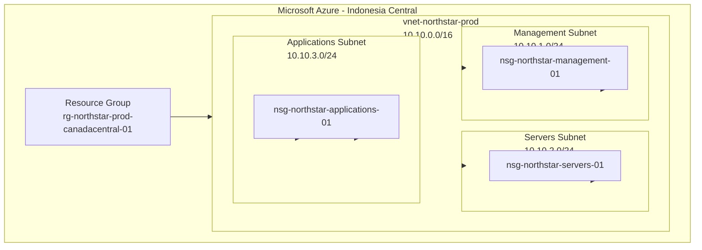
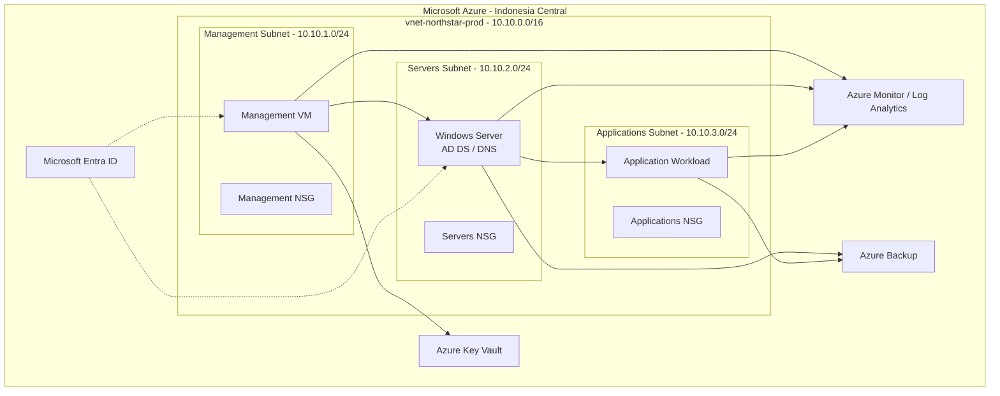

# Azure Enterprise Architecture

## Northstar Professional Services Inc.

## 1. Project Overview

This document describes the Azure infrastructure architecture for Northstar Professional Services Inc., a fictional Canadian organization with approximately 50 employees.

The architecture is being implemented incrementally as part of an enterprise-style Azure Cloud Administration and IT Operations portfolio project.

**Deployment Region:** Indonesia Central  
**Azure Subscription:** Azure subscription 1  
**Resource Group:** `rg-northstar-prod-canadacentral-01`

**Note:** The fictional organization is based in Toronto, Canada. Indonesia Central is used for this hands-on lab to manage infrastructure costs. The resource group's name contains `canadacentral`, but its actual Azure deployment region is Indonesia Central.

## 2. Current Deployment Status

The following infrastructure components have been deployed and verified:

| Component | Resource Name | Status |
|---|---|---|
| Resource Group | `rg-northstar-prod-canadacentral-01` | Deployed |
| Virtual Network | `vnet-northstar-prod` | Deployed |
| Management Subnet | `snet-management` | Deployed |
| Servers Subnet | `snet-servers` | Deployed |
| Applications Subnet | `snet-applications` | Deployed |
| Management NSG | `nsg-northstar-management-01` | Deployed and associated |
| Servers NSG | `nsg-northstar-servers-01` | Deployed and associated |
| Applications NSG | `nsg-northstar-applications-01` | Deployed and associated |

All three NSGs are associated with their respective subnets.

No project virtual machines or application workloads have been deployed yet.

## 3. Deployed Network Architecture

### Virtual Network

- **Name:** `vnet-northstar-prod`
- **Address Space:** `10.10.0.0/16`
- **Region:** Indonesia Central
- **Resource Group:** `rg-northstar-prod-canadacentral-01`

### Subnet Configuration

| Subnet | Address Range | Associated NSG |
|---|---|---|
| Management | `10.10.1.0/24` | `nsg-northstar-management-01` |
| Servers | `10.10.2.0/24` | `nsg-northstar-servers-01` |
| Applications | `10.10.3.0/24` | `nsg-northstar-applications-01` |

### Network Security Groups

Each subnet has a dedicated Network Security Group.

**Management NSG**
- Default inbound and outbound security rules currently retained.
- No custom rules currently configured.

**Servers NSG**
- Default inbound and outbound security rules retained.
- Custom inbound rules configured for DNS, Kerberos, LDAP, and SMB traffic.
- These rules are intended for internal network communication.
- Their actual service functionality will be validated after the relevant Windows Server workloads are deployed.

**Applications NSG**
- Default inbound and outbound security rules currently retained.
- No custom rules currently configured.

The default NSG rules include virtual network traffic allowances, Azure Load Balancer allowances where applicable, and default deny rules.

## 4. Current Deployed Network Diagram

This diagram represents the infrastructure deployed and verified so far.

## 5. Planned Infrastructure Architecture

The following components are planned for future implementation:

| Component | Planned Purpose | Status |
|---|---|---|
| Management VM | Administrative access and management tools | Planned |
| Windows Server | Active Directory Domain Services and DNS | Planned |
| Application Workload | Internal application hosting | Planned |
| Microsoft Entra ID | Cloud identity and access management | Planned configuration |
| Azure Monitor | Monitoring and logging | Planned |
| Log Analytics Workspace | Centralized log collection and analysis | Planned |
| Azure Backup | Backup and recovery | Planned |
| Azure Key Vault | Secure secrets management | Planned |
| PowerShell / Azure CLI | Administrative automation | Planned |
| Bicep | Infrastructure as Code | Planned |

## 6. Target Architecture Diagram

**Note:** The target architecture is a design proposal. It does not indicate that these future components have already been deployed or that the proposed connectivity has been validated.

## 7. Architecture Design Considerations

- Separate subnets are used to logically organize management, server, and application workloads.
- Dedicated NSGs provide subnet-level network traffic filtering.
- Internal communication will be restricted and validated according to workload requirements as implementation progresses.
- Administrative access will follow secure access practices.
- Azure services will be selected with cost considerations in mind.
- Monitoring, backup, identity, and governance controls will be implemented in later phases.

## 8. Project Status

**Current Phase:** Phase 1 - Cloud Infrastructure Foundation

**Completed:** Resource Group, Virtual Network, three subnets, three NSGs, subnet associations, and initial inbound/outbound NSG rule review.

**Remaining:** Network connectivity validation after workload deployment, and final network documentation verification.

This is an independent hands-on portfolio project created for practical learning and professional development. It is not a production environment for an actual organization.
