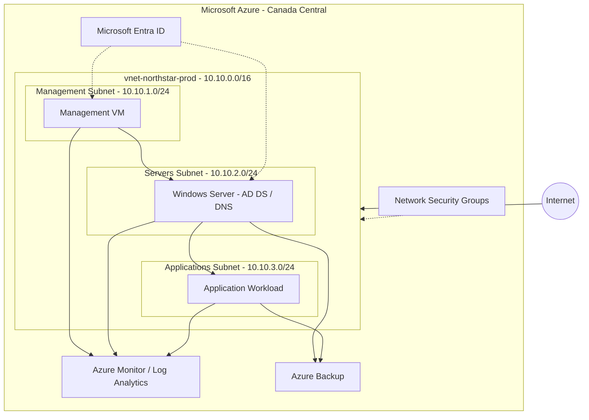

# Azure Enterprise Architecture

## Planned Infrastructure Architecture

This diagram represents the proposed Azure infrastructure
for Northstar Professional Services Inc.

## Architecture Components

| Component | Purpose |
|---|---|
| Virtual Network | Private cloud networking |
| Management Subnet | Administrative workloads |
| Servers Subnet | Windows Server infrastructure |
| Applications Subnet | Application workloads |
| Entra ID | Identity management |
| NSGs | Network traffic filtering |
| Azure Monitor | Monitoring and logging |
| Azure Backup | Data protection |

**Status:** Proposed architecture - not yet deployed.
